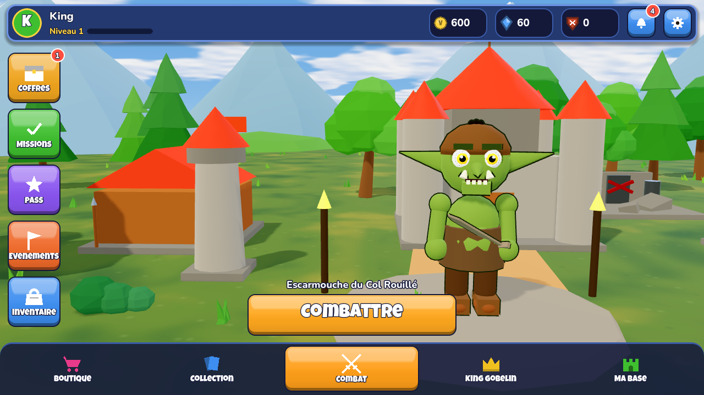
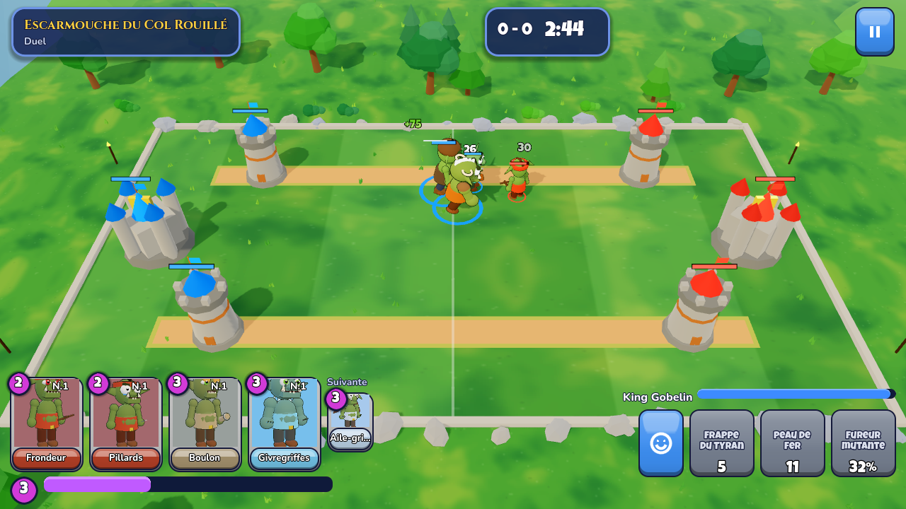
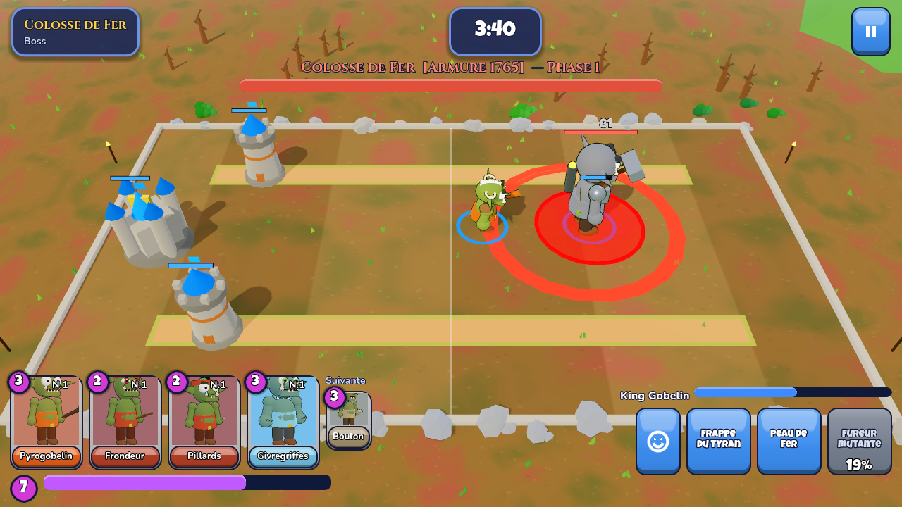
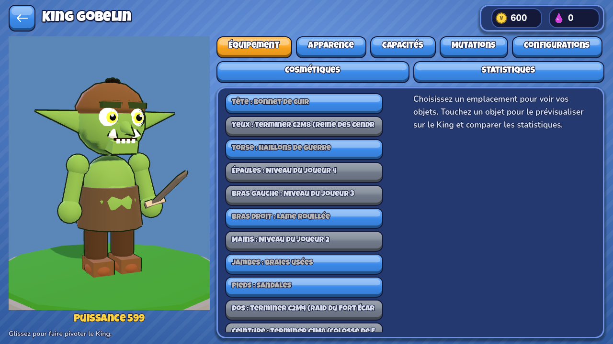
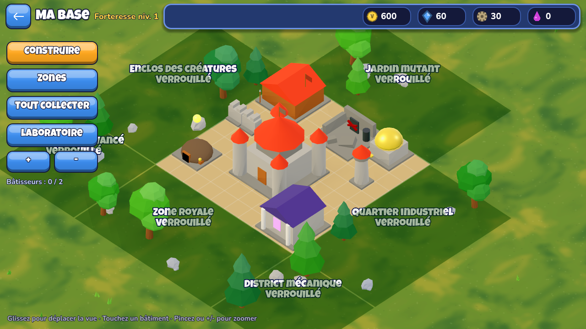
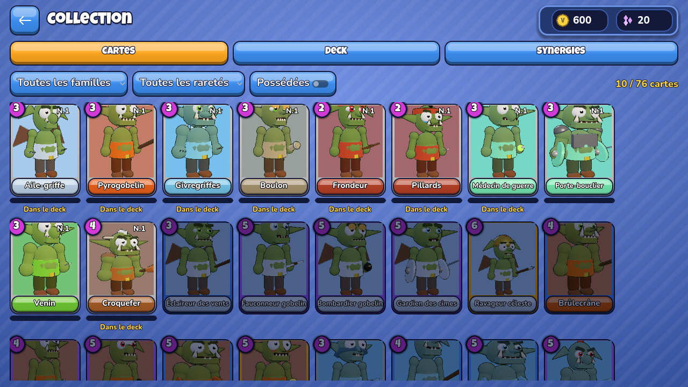
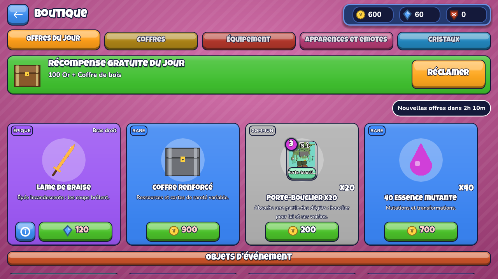

# VARKON — SuperEssence Studio

Jeu mobile Android de stratégie et de combat tactique en **2.5D (3D vue oblique / isométrique)**,
développé avec **Godot 4.4.1** (GDScript, rendu *Compatibility* OpenGL ES 3 pour une large
compatibilité Android).

Le joueur crée et équipe son **King Gobelin** unique, collectionne **76 gobelins jouables**,
développe sa **forteresse** en 3D et affronte des **bots** dans une campagne de **40 missions**,
des raids, des défenses, la survie, des défis et **5 boss** à phases.

> État : **version de test jouable (0.10.0)**. Voir [`docs/STATUS.md`](docs/STATUS.md) pour la
> liste exacte de ce qui est terminé, incomplet, et les problèmes connus.

## Captures

| Menu | Combat | Boss |
|---|---|---|
|  |  |  |
| **King Gobelin** | **Ma base** | **Collection** |
|  |  |  |
| **Boutique** | | |
|  | | |

## Contenu de la version

- **Lancement** : logo SuperEssence Studio (particules, balayage lumineux) → logo VARKON →
  King dans sa forteresse pendant un chargement réel mesuré → menu. Passable après la 1re ouverture.
- **King Gobelin** : 21 options d'apparence (visage, oreilles, nez, mâchoire, dents, défenses,
  yeux, couleurs, cicatrices, peintures, cornes, crête, cheveux, taille, carrure, musculature,
  expression, voix), 13 emplacements d'équipement visibles sur le modèle 3D, 87 objets (21 armes,
  armures, accessoires, auras, reliques), aperçu avant équipement, comparaison, plafonds, 10 capacités
  (active / défensive / ultime / passif), 7 mutations, configurations multiples, emotes et
  animations de victoire/défaite.
- **Combat** : simulation déterministe à 20 Hz, 43 types de capacités, cartes glissées sur le
  terrain, King contrôlable (déplacement + 3 capacités), synergies de familles, rage double en
  fin de duel. Modes : campagne, raid (murailles, pièges), défense (vos bâtiments de base sont
  présents), survie, défis à règles, entraînement, boss (attaques télégraphiées, armure
  destructible, phases d'épuisement).
- **Bots** : facile / normal / expert, système de scores tactiques ; ils ne voient que ce qui est
  visible sur le terrain (ni votre main, ni votre rage) et n'ont aucun bonus de statistiques.
- **Ma base** : forteresse 3D isométrique, 16 bâtiments, grille avec placement validé
  (chevauchement / limites / zones), rotation, améliorations temporisées, production plafonnée,
  7 zones à débloquer, laboratoire **verrouillé en ruine** jusqu'à : forteresse niv. 4 +
  chapitre 2 terminé + mission de réparation.
- **Laboratoire** : fabrication (forge, atelier, labo — 29 recettes), mutation, expérimentation,
  recherche (7 technologies), recyclage, reliques.
- **Économie** : 7 ressources, 8 coffres (probabilités affichées = probabilités utilisées),
  boutique (offres du jour déterministes, aperçu sur le King), pass saisonnier gratuit + premium
  (premium payé en cristaux gagnables), missions quotidiennes/hebdomadaires, 27 succès,
  événements hebdomadaires locaux.
- **Achats réels** : **non configurés** — affichés comme indisponibles, jamais simulés.
- **Sauvegarde** locale versionnée, écriture atomique, somme de contrôle, copie de secours,
  migrations, anti double-récompense.
- **Paramètres** complets (graphismes, audio par bus, commandes, accessibilité, langue FR/EN,
  notifications in-game, compte), documents légaux intégrés.

## Télécharger l'APK de test

**[`releases/VARKON-0.10.0-debug.apk`](releases/VARKON-0.10.0-debug.apk)** — Android 5.0+,
arm64-v8a / armeabi-v7a, signé avec une clé de débogage (installation directe). Voir
[`releases/README.md`](releases/README.md).

## Démarrage rapide

```bash
# Ouvrir le projet
godot --path . -e            # éditeur Godot 4.4.1

# Lancer les tests (53 tests headless, échoue aussi sur toute erreur de script)
tools/run_tests.sh

# Générer l'APK de test
godot --headless --export-debug "Android" build/VARKON-debug.apk
```

Procédure complète (SDK Android, keystore, AAB) : [`docs/BUILD.md`](docs/BUILD.md).
Architecture : [`docs/ARCHITECTURE.md`](docs/ARCHITECTURE.md).
Règles de jeu et équilibrage : [`docs/GAME_DESIGN.md`](docs/GAME_DESIGN.md).

## Arborescence

```
data/            Données de jeu JSON (générées par tools/gen_content.py — source unique)
scripts/autoload Services globaux : DB, SaveSys, Settings, Audio, Game, Router, EventBus
scripts/core     Systèmes : inventaire, collection, King, base, labo, coffres, boutique, pass, missions, campagne
scripts/combat   BattleSim (logique), BotAI, WaveDirector, BattleView (rendu 3D)
scripts/visual   Modèles 3D procéduraux : gobelins/King, équipements, bâtiments, portraits
scripts/ui       Thème, widgets et 17 écrans
tests/           Tests headless (cœur, combat, bots, équilibrage, parcours UI)
tools/           Générateurs : contenu, audio, textes FR/EN, documents légaux, scripts de test
assets/          Logos, polices sous licence libre, sons et musiques générés
docs/            Documentation, documents légaux, captures
```

## Licences

Code et contenus © SuperEssence Studio. Polices : Cinzel & Nunito (SIL OFL 1.1), Luckiest Guy
(Apache 2.0). Sons et musiques : synthétisés par `tools/generate_audio.py` (créations originales).
Moteur Godot (MIT).
